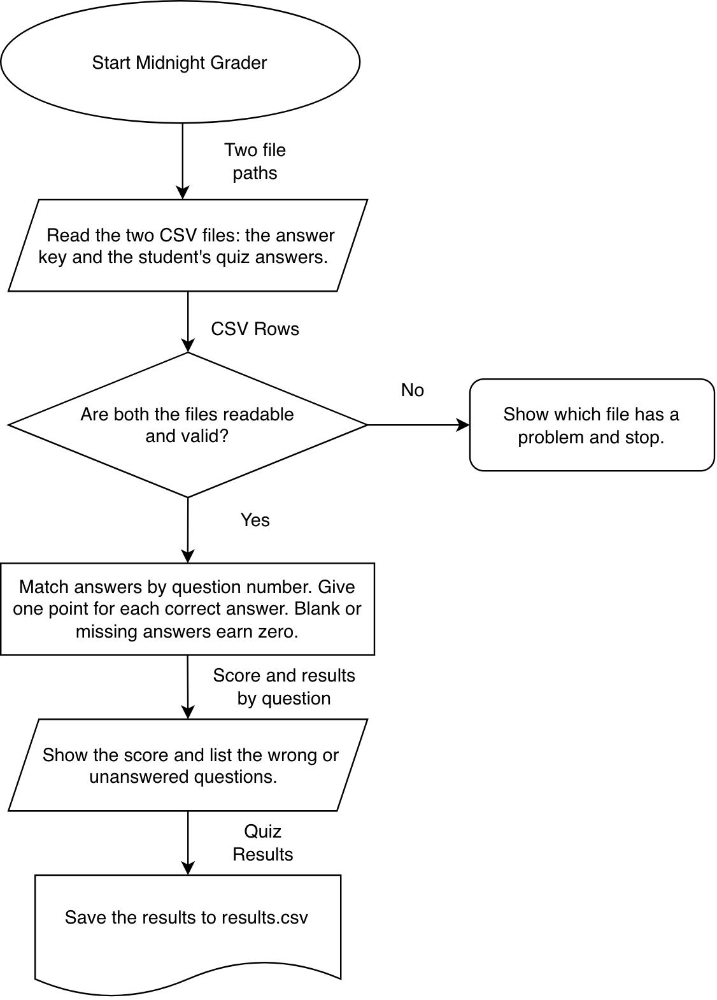

# Midnight Grader

I want to help students check their practice quizzes without having to compare every answer manually. I’m building Midnight Grader in Java for CS193, using the same tools I use in CS180. So far, I’ve finished the design and made sample quiz files to test it.

## How it will work

Give the program two CSV files: an [answer key](examples/answer-key.csv) and your [quiz answers](examples/student-answers.csv). It will match answers by question number, print your score and the questions you missed, and save the results as a CSV. Each question is worth one point. A blank or missing answer earns no points and shows up as unanswered.

For example, the sample answers should score **3/4 (75%)**, with question 2 marked wrong. The [second example](examples/student-answers-missing.csv) should get the same score, but show question 3 as unanswered.

## Build plan

- [x] Draw the diagram and make the sample files.
- [ ] Read both CSV files and check for missing files or invalid rows.
- [ ] Grade the quiz and print the results.
- [ ] Save the results and work through the [test checklist](docs/test-plan.md).
- [ ] On a separate branch, add the option to grade multiple quizzes at once.

I’ll use IntelliJ and the Java standard library. The quiz files and results will stay on the student’s computer. Later, I’d like to support questions worth different points and let students look back at earlier attempts.

[Homework 9 design PDF, including the matrix](docs/homework-9-design.pdf) · [Design notes](docs/design.md) · [Eisenhower matrix](docs/eisenhower-matrix.md) · [Editable diagram](docs/system-diagram.drawio)
