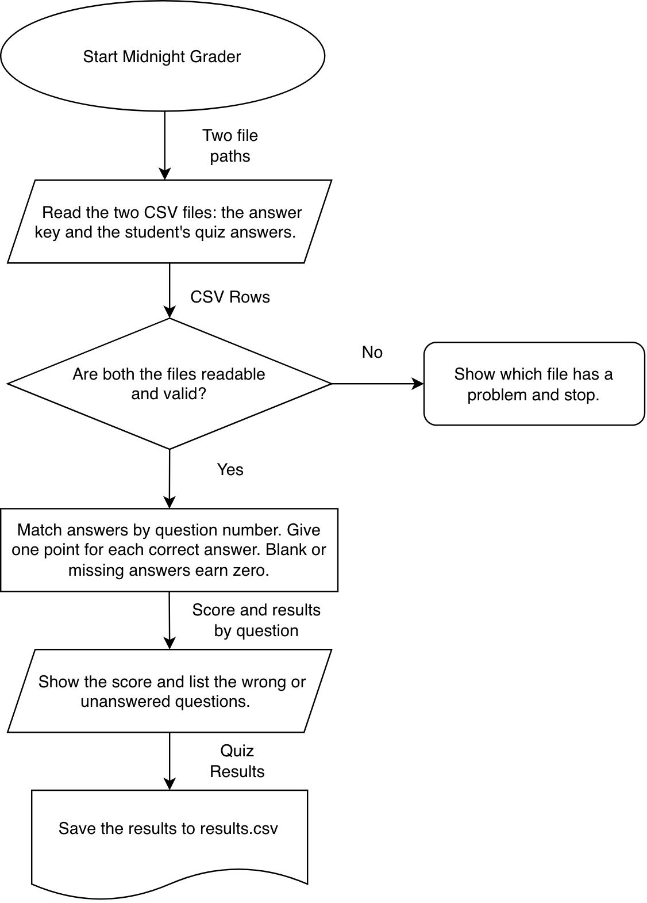

# Midnight Grader - CS193 Homework 9 Design Document

Johaan Joseph Mannanal | November 1, 2026

Status: The project plan and system diagram are ready. Java implementation has not started.

## 1.1 Problem statement

I want to help students check their practice quizzes without having to compare every answer manually. Checking answers one at a time takes time and makes it easy to miss a mistake.

## 1.2 Idea / solution

Midnight Grader will be a Java terminal program that compares a student's multiple-choice answers with an answer key. It will show their score, identify missed questions, and save the results.

## 2.1 Eisenhower Matrix and MVP

### Do - MVP
- Load an answer key and student answers.
- Compare answers and calculate a score.
- Display and export the results.

### Schedule - Later
- Grade multiple quizzes in one run.
- Support questions worth different points.
- Show results from previous attempts.

### Delegate - Use existing libraries
- Use Java's standard library for file reading and writing.
- Use Scanner for console input.
- Use Java's formatting tools for percentages.

### Delete - Outside this project
- Handwriting recognition.
- AI grading of essays.
- Accounts and cloud syncing.

### Basic grading rules

- Each question is worth one point.
- A blank or missing answer counts as incorrect and is reported as unanswered.
- Match answers by question number, not by row order.
- Report missing files or malformed input clearly.

## 2.2 Tech stack

Language: Java, using the JDK used in CS180.
Interface: Terminal prompts and text output.
Libraries: Java standard library, including file I/O, Scanner, and number formatting; no external dependencies.
Storage: Local CSV files for the answer key, student answers, and results.
Data sources: Sample quiz files I create myself; no internet service or API required.
Development tools: IntelliJ, Git, and GitHub.

### Input format

Both input files use the header `question,answer`, followed by question-number and answer pairs. Student answers can be blank. Examples are in `examples/`.

## 2.3 Chunked build plan

1. Create the repository, folder structure, README, and sample input files.
2. Read an answer-key file and check that its entries are valid.
3. Read a student-answer file and handle missing or invalid input.
4. Match questions and calculate correct, incorrect, and unanswered totals.
5. Display the score and results for each question.
6. Export the results to a CSV file.
7. Test edge cases and finish the setup instructions.
8. On a separate branch, add grading for multiple student files, test it, and merge it.

Each implementation step should be tested before moving on and committed with a descriptive message. The additional feature will be developed on its own branch and merged after both it and the original MVP work.

## 2.4 System diagram

[Editable diagram](system-diagram.drawio)

## 3.1 GitHub repository and README

Public repository: https://github.com/Johaan-Mannanal/midnight-grader-java

Homework Google Doc: https://docs.google.com/document/d/1RyccEZwJ1W4BKwszNWhDETVaH8-iuPGLJmULnyaFADA/edit

Folder structure: `src/` for future Java code, `tests/` for future tests, `docs/` for planning and the student-drawn diagram, `examples/` for synthetic input CSV files, and `output/` for generated reports.

The README contains the goal, MVP scope, future plans, tech stack, input format, current status, and links to the planning documents. Compile/run instructions will be added when there is working Java code.
